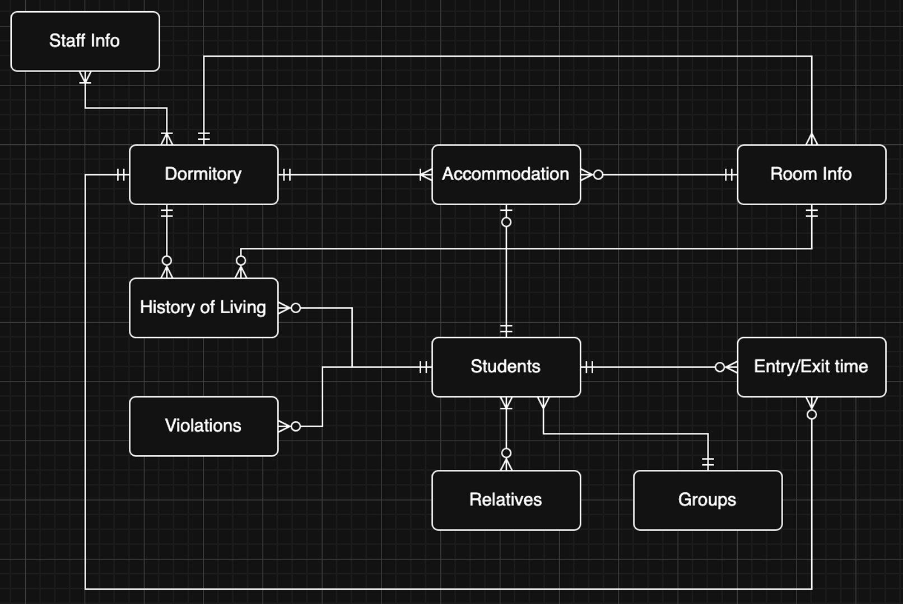
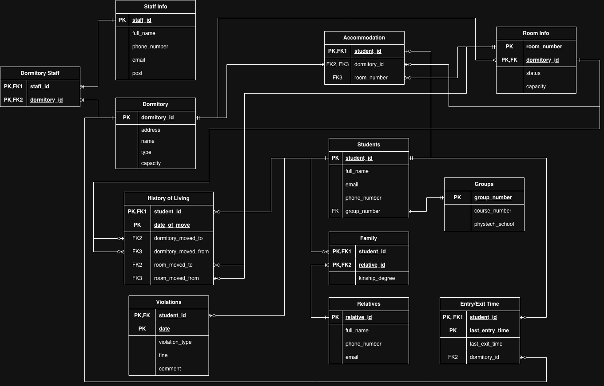
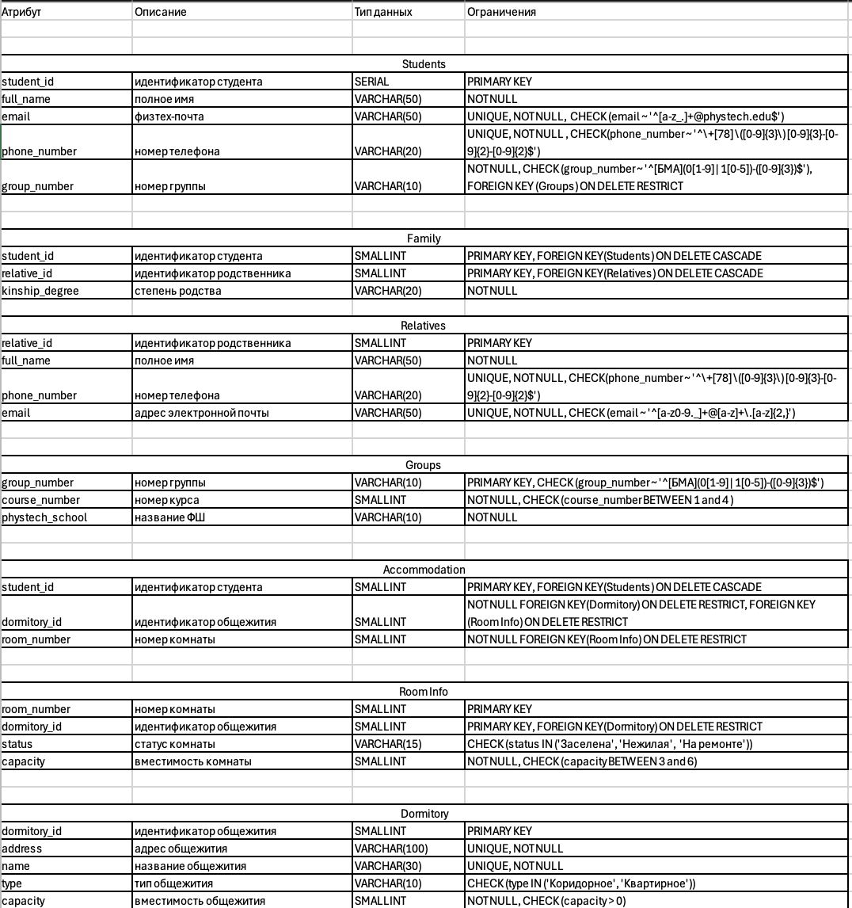
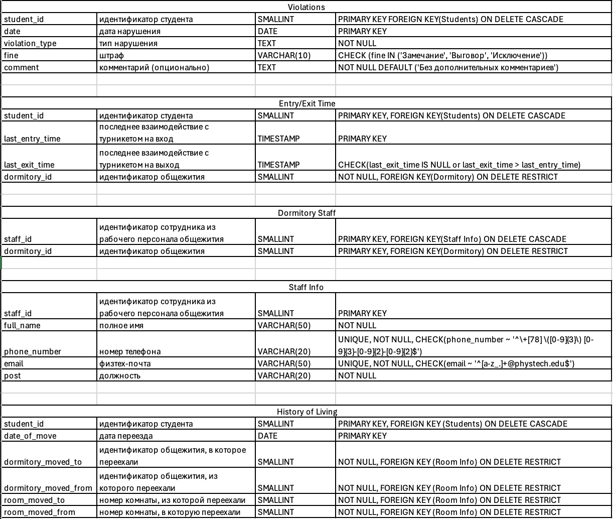

# MIPT Campus Database

A course project: a relational PostgreSQL database for managing student housing on the campus of the Moscow Institute of Physics and Technology (MIPT, "Phystech"). It models the key processes of the campus: placing students in rooms, moves between rooms and dormitories, dormitory entries and exits, violations of dormitory rules, and the work of dormitory staff.

The project goes through the full database design cycle: requirements → conceptual model → logical model → physical schema with constraints → test data → analytical queries → views, indexes, triggers, functions and procedures.

> Note: the data is synthetic. Names, phone numbers and e-mails are fictional; dormitory names and addresses follow the real MIPT campus.

---

## Contents

1. [Domain and requirements](#1-domain-and-requirements)
2. [Conceptual model](#2-conceptual-model)
3. [Logical model](#3-logical-model)
4. [Physical schema and integrity constraints](#4-physical-schema-and-integrity-constraints)
5. [Test data](#5-test-data)
6. [Analytical queries](#6-analytical-queries)
7. [Advanced part: views, indexes, triggers, functions and procedures](#7-advanced-part)
8. [Repository structure](#8-repository-structure)
9. [How to run](#9-how-to-run)

---

## 1. Domain and requirements

### What the database is for

- **Housing analytics.** Dormitory load, i.e. the number of rooms of each of the three statuses (occupied, under repair, uninhabited); the full history of each student's moves; and the actual time students spend inside the dormitories, based on turnstile entry/exit records.
- **Discipline.** Recording and processing violations of dormitory rules of different severity, from a warning to expulsion.
- **Reporting.** Reports on students, study groups, dormitories and staff.

### Questions it should answer

In practice, the administration of the campus should be able to answer everyday questions such as:

- Who lives in which dormitory and room, and how many free places are left?
- Which rooms are occupied, empty or under repair?
- Who is inside a dormitory right now, and who has not come back for several days?
- Where has a given student lived before?
- Which students have violations, and which of them have been expelled?
- Who are a student's relatives, and how can they be contacted?
- Which staff members (wardens, security guards, cleaners) work in each dormitory?

### Domain rules

The design has to respect several rules of the domain:

- A group number encodes the degree level and the Phystech school: `Б05-201` means a Bachelor's (`Б`) group of school `05` (ФПМИ); `М` stands for Master's and `А` for PhD.
- A room belongs to exactly one dormitory, and room numbers repeat across dormitories.
- A room can be occupied, uninhabited or under repair. Nobody can be placed in a room under repair.
- A student lives in at most one room at a time (some students do not live on campus at all).
- A dormitory's capacity equals the total capacity of all its rooms, regardless of their status.
- Each dormitory has exactly one warden; security guards and cleaners can work in several dormitories.

## 2. Conceptual model

The first step was to identify the entities and the relationships between them, without thinking about tables yet.



Key relationships and their cardinalities (crow's foot notation):

| Relationship | Cardinality | Meaning |
|---|---|---|
| Groups — Students | one and only one → one or many | every student belongs to exactly one group; a group has several students |
| Students — Relatives | zero or many ↔ one or many | a student may have no relatives on record; a relative always belongs to at least one student (siblings share relatives) |
| Students — Accommodation | one and only one → zero or one | some students do not live on campus |
| Dormitory — Room Info | one and only one → one or many | a dormitory consists of many rooms |
| Accommodation — Dormitory | one or many → one and only one | each placement is in exactly one dormitory |
| Staff — Dormitory | one or many ↔ one or many | a guard may work in several dormitories; a dormitory has several staff members |
| Students — History of Living | one → zero or many | a student may have moved several times |
| Students — Violations / Entry-Exit Time | one → zero or many | event logs per student |

## 3. Logical model

Next, the entities were turned into relations with primary and foreign keys. Many-to-many relationships were resolved with junction tables (`family`, `dormitory_staff`), and composite keys were introduced where the natural identifier consists of several attributes.



Design decisions worth noting:

- **Rooms have a composite key** `(room_number, dormitory_id)`, because room 101 exists in many dormitories. Every table that references a room (`accommodation`, `history_of_living`) uses a composite foreign key.
- **Relatives are a separate entity** linked through `family(student_id, relative_id, kinship_degree)`, so siblings who study at MIPT can share the same parent record without duplicating data.
- **Current state and history are separated.** `accommodation` stores where a student lives *now*; `history_of_living` stores every move, with both "from" and "to" rooms (both nullable, so that the first check-in has no "from" room).
- **Event logs use natural composite keys:** a violation is identified by `(student_id, date)`, and a dormitory visit by `(student_id, last_entry_time)`.

The model is in third normal form: every non-key attribute depends only on the key of its table (e.g. a dormitory's address is stored once in `dormitory`, not repeated for each room or resident).

## 4. Physical schema and integrity constraints

Before writing any SQL, every attribute was specified in a physical design table: description, PostgreSQL data type and constraints ([`schemas/Physical_Scheme/Physical_Scheme_DB.xlsx`](schemas/Physical_Scheme/Physical_Scheme_DB.xlsx)):




The schema is then implemented in [`base_part/create.sql`](base_part/create.sql). All tables live in a separate schema, `campus`. 12 tables:

| Table | Purpose |
|---|---|
| `groups` | study groups: number, year of study, Phystech school |
| `students` | personal and contact data, group |
| `relatives`, `family` | relatives and their kinship to students |
| `dormitory` | dormitories: name, address, type (corridor or apartment style), capacity |
| `room_info` | rooms: number, dormitory, status, capacity |
| `accommodation` | current placement of each student |
| `history_of_living` | full history of moves between rooms and dormitories |
| `entry_exit_time` | dormitory entry/exit log |
| `violations` | disciplinary violations and penalties |
| `staff_info`, `dormitory_staff` | staff and the dormitories they work in |

Business rules are enforced in the database itself, not only in application code:

- **Format checks with regular expressions:**
  - group number: `^[БМА](0[1-9]|1[0-5])-([0-9]{3})$`;
  - student and staff e-mails must be in the `@phystech.edu` domain;
  - phone numbers must follow `+7 (XXX) XXX-XX-XX`.
- **Domain checks:** year of study between 1 and 4; room capacity between 3 and 6; dormitory capacity is positive.
- **Enumerated values:** room status (`Заселена` / `Нежилая` / `На ремонте` — occupied / uninhabited / under repair), dormitory type, and penalty type (`Замечание` / `Выговор` / `Исключение` — warning / reprimand / expulsion).
- **Temporal consistency:** a dormitory exit must be later than the entry (`last_exit_time is null or last_exit_time > last_entry_time`); `null` means the student is still inside.
- **Uniqueness:** e-mails, phone numbers, dormitory names and addresses.
- **Deliberate referential actions:**
  - `ON DELETE CASCADE` for data that has no meaning without the student (accommodation, violations, history, family links);
  - `ON DELETE RESTRICT` for "infrastructure" (a dormitory or a room cannot be deleted while someone lives there or references it in their history; a group cannot be deleted while it has students).

## 5. Test data

The tables are filled with a realistic synthetic dataset ([`base_part/insert.sql`](base_part/insert.sql); the same data is also available as CSV in [`data/`](data/)):

| Table | Rows |
|---|---|
| students | 579 |
| groups | 74 (11 Phystech schools; Bachelor's, Master's and PhD) |
| dormitory | 15 (real MIPT dormitories, incl. Zhukovsky and Zyuzino) |
| room_info | 1,068 |
| accommodation | 579 |
| history_of_living | 649 |
| entry_exit_time | 7,605 (about two months of logs) |
| relatives / family | 182 / 182 |
| violations | 112 |
| staff_info / dormitory_staff | 35 / 62 |

The raw rows were generated with an LLM, but only after the schema and the relationships were fixed, and under a detailed list of rules written for this project. The full process is documented in [`data/prompt.txt`](data/prompt.txt):

1. First, the model was given the `CREATE` script and asked to list every relationship in crow's foot notation. Its mistakes were corrected by hand (for example, `groups → students` must be "one to strictly more than one", and the missing `accommodation ↔ dormitory` relationship was added) before any data was generated.
2. Then 18 data-level rules were specified, including:
   - students of different sexes, schools or years cannot share a room;
   - an uninhabited room has no residents;
   - each dormitory has exactly one warden;
   - the number of rooms must cover the dormitory's capacity;
   - kinship must match the relative's sex;
   - some "dead souls" must be present: students who have not entered a dormitory for several days;
   - every relationship type must be illustrated by at least one example (e.g. a dormitory that has only a warden).
3. The result was checked and corrected by hand: missing dormitories were added, wrong addresses fixed, and group numbers aligned with the Phystech school numbering.

[`advanced_part/settings.sql`](advanced_part/settings.sql) then brings the data into a consistent state: rooms marked as occupied but without residents become uninhabited, and the `student_id` sequence is synchronized with the explicitly inserted IDs, so new students get correct IDs.

## 6. Analytical queries

[`base_part/select.sql`](base_part/select.sql) contains 10 queries that answer real administrative questions. Together they cover the main SQL techniques:

| # | Question | Techniques |
|---|---|---|
| 1 | Who is inside a dormitory right now? | subquery, `INNER JOIN`, `IS NULL` |
| 2 | Each student's full living path: `dorm 1, room 1 -> ... -> dorm n, room n` | **recursive CTE**, correlated subqueries, `NOT EXISTS` |
| 3 | Number of security guards in each dormitory | `LEFT JOIN` with a condition in `ON` (keeps dormitories with zero guards) |
| 4 | Groups with students who have violations, and how many | derived table, `GROUP BY` / `HAVING` |
| 5 | Relatives with at least two children at MIPT | multi-table join, `HAVING` |
| 6 | Number of rooms of each status per dormitory | three aggregated `LEFT JOIN`s, `COALESCE` |
| 7 | Rooms shared by students from different groups | `COUNT(DISTINCT ...)` |
| 8 | Occupied and free places per dormitory | aggregation over `LEFT JOIN` |
| 9 | Number of Bachelor's students per school and year | `LIKE`, grouping by two keys |
| 10 | Students who have not appeared in any dormitory for more than 3 days | several CTEs, `CROSS JOIN`, date arithmetic |

## 7. Advanced part

### Views — [`advanced_part/views.sql`](advanced_part/views.sql)

- **`students_inside_dormitories`** — who is inside a dormitory right now and for how long. A window function (`ROW_NUMBER() OVER (PARTITION BY student_id ORDER BY last_entry_time DESC)`) keeps only the latest open entry per student, so the view stays correct even if the log contains inconsistent rows (an entry without a matching exit).
- **`room_types_number`** (materialized) — number of occupied, uninhabited and under-repair rooms in each dormitory. It is materialized because room statuses change rarely while the table is large (1,000+ rooms); refreshing it once a month (or once a semester) is enough. It is reused by the load function below.

### Indexes — [`advanced_part/indexes.sql`](advanced_part/indexes.sql)

Each index targets a specific access pattern used by the queries above:

- **`idx_room_info_dormitory_id`** on `room_info (dormitory_id, status)` — a composite index for joining rooms to dormitories and filtering by status at the same time (queries 6 and 8, the materialized view).
- **`idx_violations_bad_types`** — a **partial index** on `violations (student_id) WHERE fine IN ('Выговор', 'Исключение')`. It indexes only serious violations, which are the ones the administration searches for, so the index stays small.
- **`idx_students_group_number`** on `students (group_number)` — speeds up joins with `groups` and lookups by group. PostgreSQL does not index foreign keys automatically.

### Triggers — [`advanced_part/triggers.sql`](advanced_part/triggers.sql)

Room status is kept up to date automatically, so it can never contradict who actually lives in the room:

- **`trg_room_status_insertion`** (`AFTER INSERT`, row-level) — when the first student moves into a room, its status becomes "occupied".
- **`trg_room_status_accommodation_delete`** (`AFTER DELETE`, **statement-level**) — after any deletion from `accommodation`, every occupied room that has no residents left becomes "uninhabited". It is statement-level on purpose: a mass deletion (e.g. expelling several students at once) triggers one check instead of one per deleted row. It also reports how many rooms were released.

### Functions and procedures — [`advanced_part/functions.sql`](advanced_part/functions.sql)

- **`add_student(...)`** (procedure) — the only correct way to check a new student into the campus. In a single call it:
  1. validates the input: the room and the group must exist, the room must not be full, the group must have fewer than 20 students, and the room must not be under repair;
  2. inserts the student and retrieves the generated ID (`INSERT ... RETURNING`);
  3. creates the accommodation record (which fires the trigger that marks the room as occupied);
  4. writes the first entry to `history_of_living`.
  
  Any failed check raises an exception, so a half-registered student cannot appear in the database.
- **`remove_excluded_students()`** (procedure) — removes all expelled students. Their accommodation, history and logs are deleted through `ON DELETE CASCADE`, the trigger releases rooms that become empty, and the procedure then deletes groups that have no students left. It reports how many students and groups were removed (uses `GET DIAGNOSTICS ... ROW_COUNT`).
- **`dormitory_living_or_repair_load(dormitory_id)`** (function returning a table) — the share of occupied (including under-repair) and free rooms in a dormitory, based on the materialized view. Raises an error for a nonexistent dormitory and returns `NULL` on `NULL` input.

The three parts work together. For example, calling `remove_excluded_students()` on the test data removes 5 expelled students, and the trigger automatically moves the room left empty to "uninhabited", with no extra code.

## 8. Repository structure

```
MIPT_campus_db/
├── schemas/
│   ├── Concept_Scheme_DB.png     # conceptual model
│   ├── Logical_Scheme_DB.png     # logical model (crow's foot notation)
│   └── Physical_Scheme/          # physical design: types and constraints per attribute
│       ├── Physical_Scheme_DB.xlsx
│       ├── pic_1.png
│       └── pic_2.png
├── base_part/
│   ├── create.sql                # physical schema: tables and constraints
│   ├── insert.sql                # test data
│   └── select.sql                # 10 analytical queries
├── advanced_part/
│   ├── settings.sql              # data consistency fixes after loading
│   ├── views.sql                 # view and materialized view
│   ├── indexes.sql               # indexes
│   ├── triggers.sql              # room status triggers
│   └── functions.sql             # procedures and a function
└── data/
    ├── *.csv                     # the same data in CSV format
    └── prompt.txt                # how the test data was generated and checked
```

## 9. How to run

Requires PostgreSQL (tested on PostgreSQL 16). Run the scripts in this order: views must exist before the functions that use them, and triggers are created after the initial load.

```bash
createdb campus_db

psql -d campus_db -f base_part/create.sql
psql -d campus_db -f base_part/insert.sql
psql -d campus_db -f advanced_part/settings.sql
psql -d campus_db -f advanced_part/views.sql
psql -d campus_db -f advanced_part/indexes.sql
psql -d campus_db -f advanced_part/triggers.sql
psql -d campus_db -f advanced_part/functions.sql

psql -d campus_db -f base_part/select.sql
```

Examples:

```sql
-- who is in a dormitory right now
SELECT * FROM campus.students_inside_dormitories;

-- room load of dormitory 1
SELECT * FROM campus.dormitory_living_or_repair_load(1);

-- check a new student in
CALL campus.add_student('Иванова Анна Сергеевна', 'anna.ivanova@phystech.edu',
                        '+7 (999) 123-45-67', 1::smallint, 101::smallint, 'Б05-201');

-- remove expelled students
CALL campus.remove_excluded_students();
```
